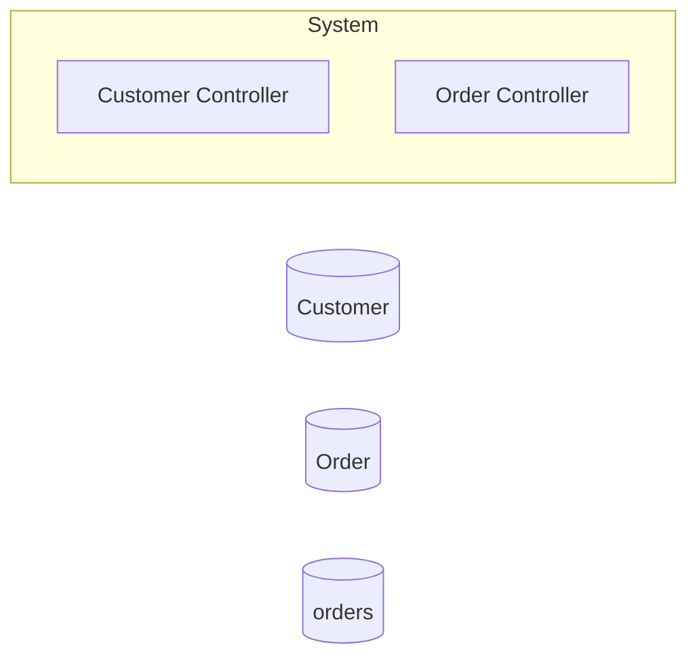

# Architecture

## System Diagram

## Components

### Services

- **CustomerController**: POST /api/customers, GET /api/customers/{id}
- **OrderController**: POST /api/orders, GET /api/orders/{id}, POST /api/orders/{id}/place, +2 more

### Databases

- **Customer**: SQL database
- **Order**: SQL database
- **orders**: SQL database

## Reference

For the complete CALM (Common Architecture Language Model) schema, see [calm-architecture.json](calm-architecture.json).
